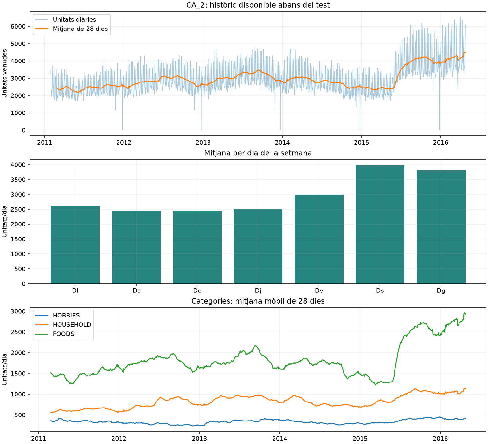
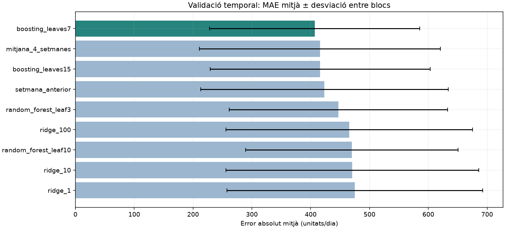
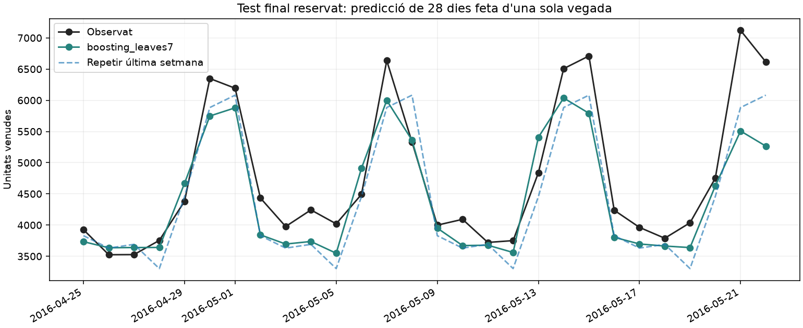
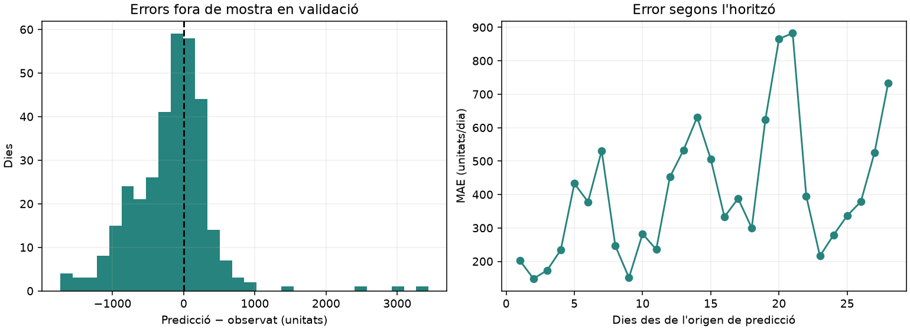
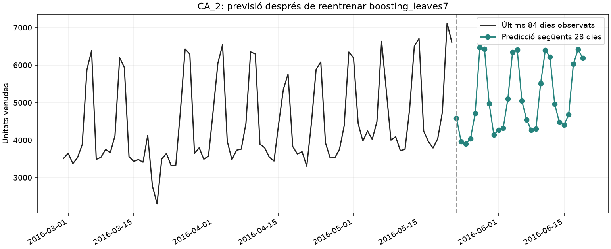

# Predicció de les vendes diàries de Walmart CA_2

## Resultat principal

El model seleccionat exclusivament amb validació temporal és **boosting_leaves7**.
El seu MAE de validació és **406.8 unitats/dia** (3.9% de reducció respecte de repetir l'última setmana).
Al test final reservat obté **MAE 415.5**, **RMSE 553.5** i **WAPE 8.75%**.
La reducció de MAE al test respecte d'aquesta referència és del **-0.3%**; un valor negatiu indica empitjorament.
El model seleccionat no millora la referència setmanal en aquest test. La millora modesta de validació no es trasllada al període final; aquest és un resultat a informar, no un motiu per reajustar sobre el test.
El test no s'utilitza per escollir ni modificar el model.

## 1. Objectiu i abast

Predir, d'una sola vegada, les **unitats totals venudes cada dia durant 28 dies** a la botiga CA_2.
La variable objectiu és la suma diària dels 3,049 productes del subconjunt M5.
No és facturació en dòlars, ni implica cobrir tot l'assortiment real de la botiga.
La pràctica és una regressió supervisada sobre una sèrie temporal agregada; no és una submissió oficial a Kaggle, que requereix prediccions per producte.

## 2. Dades i qualitat

- Font local: `sales_train_validation.csv`, `sales_train_evaluation.csv` i `calendar.csv`.
- Entrenament i selecció: 2011-01-29 – 2016-04-24 (1913 dies).
- Test reservat: 2016-04-25 – 2016-05-22 (28 dies addicionals d'evaluation).
- Dies consecutius, sense cel·les de vendes buides ni valors negatius; productes sense duplicats.
- S'ha comprovat la igualtat producte a producte entre validation i el prefix compartit d'evaluation.
- No es concatenen els dos fitxers: evaluation ja inclou l'històric de validation.
- Les vendes zero d'un producte es conserven: zero no és una dada absent. Les caigudes de Nadal tampoc s'eliminen.
- Els CSV d'entrada i el ZIP original no es modifiquen durant l'execució.

`wm_yr_wk` identifica la setmana comercial i permet relacionar calendari i preus.
En aquesta primera versió no s'utilitzen preus: caldria definir un índex de cistella i saber quins preus futurs estarien disponibles a l'origen de la predicció.
Ponderar els preus amb les vendes del període futur introduiria informació que el model no tindria.

## 3. Exploració abans del test

La mitjana és de **2972.0 unitats/dia**. Els caps de setmana tenen un volum mitjà **49.7% superior** al dels dies laborables.
L'autocorrelació a set dies és **0.881**.
Aquestes estadístiques i els gràfics exploratoris només utilitzen validation.
Les mitjanes per dia de la setmana són descriptives i no demostren causalitat.
El gràfic també mostra un canvi de nivell marcat a mitjan 2015, especialment a FOODS.
Amb aquests fitxers no podem establir la causa del canvi; tractar tota la sèrie com si tingués un nivell estable seria una simplificació forta.

## 4. Variables i prevenció de filtracions

- Dia de la setmana, dia del mes, inici/final de mes i tendència.
- Tres parelles de sinus/cosinus per representar el cicle anual.
- Indicadors de festius, tipus d'esdeveniment i `snap_CA`, assumint que el calendari futur és conegut.
- Retards de **28, 35, 42, 49, 56, 364 i 371 dies**.
- Mitjanes i desviacions de 7, 28 i 56 dies acabades **28 dies abans de la data objectiu**, i mitjana del mateix dia de la setmana en quatre setmanes anteriors a aquest desplaçament.

Per a un bloc que comença a l'índex `c`, l'últim dia a predir és `c+27`.
El retard més curt d'aquell dia consulta `c+27-28 = c-1`: sempre una observació anterior al bloc.
No es fan servir retards d'1 o 7 dies amb valors reals del període a predir.
Els 28 dies es calculen simultàniament, sense actualitzar el model amb vendes reals dins del bloc.
El compromís és que, als horitzons curts, els predictors de vendes són menys recents del que podrien ser amb models directes específics per horitzó.

Les primeres 371 dates serveixen d'històric per construir retards i no són files d'entrenament supervisat.
L'estandardització de Ridge s'ajusta dins de cada entrenament; els arbres no necessiten estandardització.

## 5. Disseny experimental

Validació amb **12 blocs consecutius de 28 dies**, des de 2015-05-25 fins a 2016-04-24.
En cada bloc s'entrena només amb els dies anteriors, ampliant l'històric.
El conjunt de candidats es fixa al codi abans del test: dues referències, tres valors d'alpha per Ridge, dues mides mínimes de fulla per Random Forest i dues mides d'arbre per boosting.
No hi ha divisió aleatòria ni selecció per rendiment al test.

El criteri principal és el **MAE mitjà dels blocs**, expressat en unitats/dia.
També es publiquen RMSE, WAPE i MASE estacional a 7 dies. MASE es divideix per l'error mitjà de repetir la setmana anterior dins de l'entrenament de cada bloc.
`bias = mitjana(predicció − observat)`: positiu vol dir sobreestimació.
S'evita MAPE perquè hi ha dies amb molt poques vendes.
Les desviacions entre blocs descriuen variabilitat; no són intervals de confiança.
La mètrica no és el WRMSSE jeràrquic oficial de M5.

## 6. Comparació en validació

| Model | MAE | Desv. MAE | RMSE | WAPE (%) | MASE7 |
| --- | --- | --- | --- | --- | --- |
| boosting_leaves7 | 406.840 | 178.824 | 553.398 | 10.403 | 1.571 |
| mitjana_4_setmanes | 415.763 | 204.966 | 575.814 | 10.706 | 1.610 |
| boosting_leaves15 | 415.939 | 187.025 | 569.430 | 10.642 | 1.606 |
| setmana_anterior | 423.357 | 210.596 | 606.266 | 10.891 | 1.640 |
| random_forest_leaf3 | 447.043 | 185.472 | 606.787 | 11.458 | 1.730 |
| ridge_100 | 465.559 | 209.421 | 594.835 | 11.992 | 1.810 |
| random_forest_leaf10 | 470.182 | 180.620 | 630.745 | 12.048 | 1.823 |
| ridge_10 | 470.733 | 214.998 | 597.888 | 12.121 | 1.830 |
| ridge_1 | 475.095 | 217.387 | 601.741 | 12.226 | 1.846 |

## 7. Test final reservat

La selecció queda congelada abans d'avaluar aquest període.
Es mostra el model escollit per família en validació i les dues referències; aquesta taula no es fa servir per tornar a seleccionar.

| Model | MAE | RMSE | WAPE (%) | MASE7 | Biaix |
| --- | --- | --- | --- | --- | --- |
| setmana_anterior | 414.357 | 500.495 | 8.729 | 1.508 | -336.000 |
| mitjana_4_setmanes | 372.446 | 459.023 | 7.846 | 1.356 | -281.750 |
| ridge_100 | 326.741 | 450.213 | 6.883 | 1.189 | -229.905 |
| random_forest_leaf3 | 619.549 | 754.182 | 13.051 | 2.255 | -552.728 |
| boosting_leaves7 | 415.481 | 553.485 | 8.752 | 1.512 | -306.186 |

## 8. Previsió després del test

Amb el mateix model i hiperparàmetres seleccionats, es reentrena amb els 1941 dies observats fins al 2016-05-22.
La previsió cobreix **2016-05-23 – 2016-06-19**, amb un total esperat de **143,079.9 unitats**.
Aquestes dates són el futur respecte del conjunt M5, no respecte de la data actual.
No es disposa dels valors reals d'aquest període als fitxers locals; no se'n calcula cap error.
Les prediccions decimals són valors esperats i es limiten inferiorment a zero.
No s'han calculat intervals de predicció.

## 9. Interpretació i límits

El model seleccionat no millora la referència setmanal en aquest test. La millora modesta de validació no es trasllada al període final; aquest és un resultat a informar, no un motiu per reajustar sobre el test.
El biaix al test del model seleccionat és de **-306.2 unitats/dia**; el signe indica si sobreestima o infraestima el volum.
La botiga s'ha escollit després d'examinar descriptivament validation; el resultat és específic de CA_2 i no una estimació sobre totes les botigues.
Un únic test de 28 dies no representa totes les estacions de l'any. La validació cobreix diversos mesos, però els errors temporals poden estar correlacionats.
La venda observada no és demanda latent: sense inventari no podem distingir falta de demanda i ruptures d'estoc.
La importància per permutació, si el guanyador és un model supervisat, es calcula en l'últim bloc de validació; és descriptiva, inestable amb 28 observacions i afectada per predictors correlacionats.
Una extensió raonable seria provar models directes per horitzó i un índex de preus definit amb pesos calculats exclusivament amb dades passades.

## 10. Reproducció i referències

Des de l'arrel de la pràctica: `python -m ca2_forecast --output-dir outputs`.
Vegeu `README.md` per preparar l'entorn i obrir `practica.py` amb Marimo.
`manifest.json` registra versions, configuració i empremtes SHA-256 dels fitxers d'entrada.
La llavor dels models és 42; petites diferències entre plataformes i versions són possibles.

Referència metodològica: [scikit-learn: variables retardades i avaluació temporal](https://scikit-learn.org/stable/auto_examples/applications/plot_time_series_lagged_features.html).
Font de les dades: [M5 Forecasting — Accuracy](https://www.kaggle.com/competitions/m5-forecasting-accuracy).
