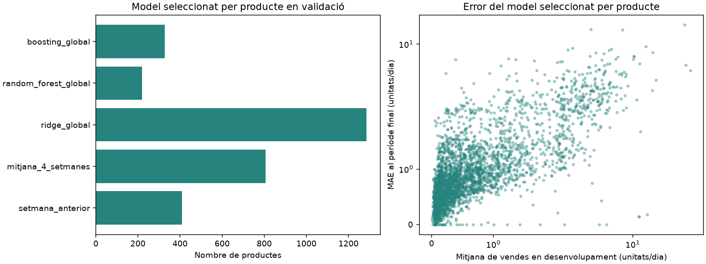
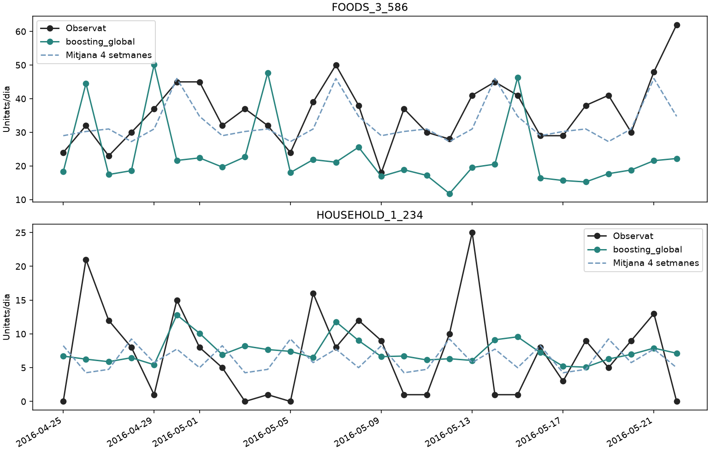
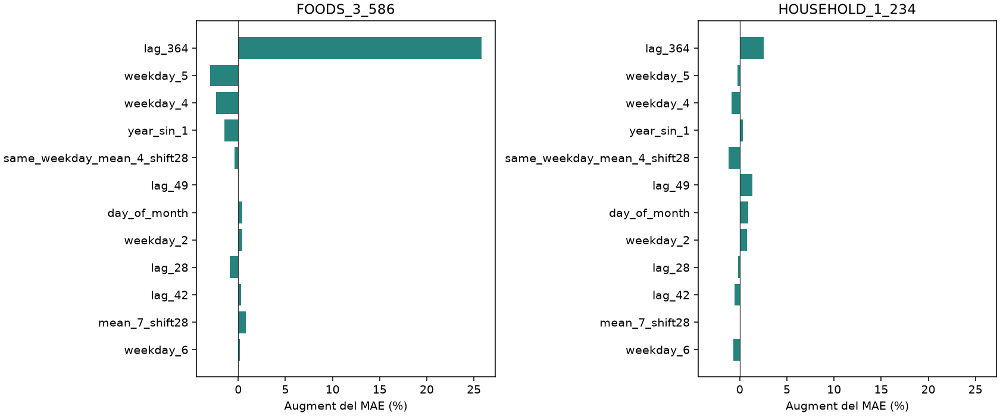

# Predicció i comparació per productes de CA_2

S'han generat prediccions separades dels **3049 productes**, sense limitar l'avaluació a una mostra de productes.
El model triat per a cada producte s'escull pel seu MAE mitjà en 12 blocs de validació temporal de 28 dies.
El MAE mitjà dels productes al període final és **1.159 unitats/producte/dia**.
El WAPE abans de sumar productes és **74.43%**; després de sumar-los és **8.71%**.
Aquesta diferència reflecteix la compensació d'errors entre productes; no són dues estimacions del mateix error.

## Disseny

- Es mantenen els mateixos 12 blocs per defecte i les mateixes dates del període final que a l'experiment agregat.
- Ridge, Random Forest i gradient boosting són **models globals compartits**, entrenats amb observacions producte/dia de tots els productes. No s'han ajustat 3.049 estimadors independents.
- Cada producte té els seus retards, mitjanes, dispersions i freqüències de zeros. També entren calendari i departament. No es dóna un ordre numèric arbitrari als identificadors de producte.
- Per controlar el cost es mostregen uniformement amb reemplaçament **32 dates per producte i bloc**, sempre anteriors a l'origen. Cada model supervisat veu 97,568 files per entrenament. No s'ajusta sobre totes les parelles producte/dia.
- Les dues referències utilitzen l'històric complet necessari del producte. Tots els productes s'avaluen en tots els dies de cada bloc.
- Els paràmetres dels tres models supervisats estan fixats al codi; es tria entre cinc mètodes per producte, sense cercar hiperparàmetres al període final.
- La selecció es desa abans d'avaluar el període final. Aquest període ja s'havia examinat a nivell agregat en la versió anterior: permet comparar nivells, però no és una nova avaluació totalment independent de tot el desenvolupament.

## Comparació de models en validació

MAE mitjà i mediana es calculen entre productes. El WAPE agrupa errors absoluts de tots els productes **abans** de sumar prediccions.

| Model | MAE mitjà | Mediana MAE | WAPE (%) | Productes seleccionats |
| --- | --- | --- | --- | --- |
| setmana_anterior | 1.253 | 0.902 | 95.313 | 410 |
| mitjana_4_setmanes | 1.095 | 0.792 | 83.259 | 806 |
| ridge_global | 1.073 | 0.769 | 81.635 | 1286 |
| random_forest_global | 1.117 | 0.800 | 84.966 | 219 |
| boosting_global | 1.109 | 0.791 | 84.365 | 328 |

## Error per producte i error del total al període final

`product_mae_mean` és l'error d'un producte mitjà. `store_mae` és l'error diari del total després de sumar prediccions.
Les files `total_directe` provenen de l'experiment original, que prediu directament el total i no proporciona errors individuals.

| Model | MAE producte | WAPE productes (%) | MAE total | WAPE total (%) |
| --- | --- | --- | --- | --- |
| setmana_anterior | 1.363 | 87.570 | 414.357 | 8.729 |
| mitjana_4_setmanes | 1.192 | 76.537 | 372.446 | 7.846 |
| ridge_global | 1.170 | 75.169 | 467.225 | 9.842 |
| random_forest_global | 1.177 | 75.594 | 447.242 | 9.421 |
| boosting_global | 1.186 | 76.146 | 344.500 | 7.257 |
| seleccio_per_producte | 1.159 | 74.426 | 413.275 | 8.706 |
| total_directe:setmana_anterior | — | — | 414.357 | 8.729 |
| total_directe:mitjana_4_setmanes | — | — | 372.446 | 7.846 |
| total_directe:ridge_100 | — | — | 326.741 | 6.883 |
| total_directe:random_forest_leaf3 | — | — | 619.549 | 13.051 |
| total_directe:boosting_leaves7 | — | — | 415.481 | 8.752 |

## Deu productes amb més volum en desenvolupament

S'han escollit per volum anterior al període final, no pel seu error final.
La taula completa dels 3049 productes és a `resum_productes.csv` i al quadern Marimo.

| Producte | Model triat | Unitats/dia històriques | MAE validació | MAE final | WAPE final (%) | Variable del millor model supervisat |
| --- | --- | --- | --- | --- | --- | --- |
| FOODS_3_586 | mitjana_4_setmanes | 33.150 | 9.865 | 5.464 | 15.224 | lag_28 |
| FOODS_3_252 | mitjana_4_setmanes | 29.968 | 11.482 | 6.143 | 17.695 | lag_28 |
| FOODS_3_090 | setmana_anterior | 29.362 | 17.089 | 15.571 | 29.579 | lag_364 |
| FOODS_3_555 | mitjana_4_setmanes | 16.205 | 6.595 | 4.357 | 22.182 | lag_28 |
| FOODS_1_218 | ridge_global | 15.078 | 8.099 | 8.267 | 89.725 | mean_28_shift28 |
| FOODS_3_080 | mitjana_4_setmanes | 15.004 | 5.336 | 3.411 | 24.935 | lag_35 |
| FOODS_3_808 | setmana_anterior | 13.492 | 8.905 | 0.179 | 166.667 | mean_56_shift28 |
| FOODS_3_804 | ridge_global | 13.096 | 7.384 | 9.423 | 47.713 | lag_35 |
| FOODS_3_635 | mitjana_4_setmanes | 11.693 | 10.424 | 1.679 | 470.000 | lag_42 |
| FOODS_3_288 | mitjana_4_setmanes | 11.475 | 11.149 | 6.357 | 20.159 | lag_35 |

Exemple de prediccions de boosting (no necessàriament el mètode seleccionat) per a **FOODS_3_586** i **HOUSEHOLD_1_234**, escollits pel volum en desenvolupament en dues categories diferents:

## Importància de les variables per producte

Es calcula per **cadascun dels tres models supervisats i cadascun dels productes**, en el bloc de validació 2016-03-28 — 2016-04-24.
Es permuta una variable entre els 28 dies **del mateix producte**, 3 vegades, i es mesura quant augmenta el seu MAE.
Una importància positiva indica que el model empitjora quan es desordena aquella variable; una de negativa pot reflectir soroll o una variable perjudicial.
No és un efecte causal ni una propietat intrínseca del producte.

`mae_increase` està en unitats/producte/dia. `mae_increase_pct` divideix aquest augment pel MAE original del mateix model/producte en aquest bloc; permet comparar productes de volums diferents. Si el MAE original és zero, el percentatge queda sense definir.
Les variables constants dins del producte/bloc, com el departament, tenen importància local zero: això no implica que siguin inútils per al model global.
Només 28 observacions i tres repeticions donen una mesura exploratòria; els retards i mitjanes correlacionats poden repartir-se o amagar importància.
Les referències no tenen un estimador supervisat i no reben importàncies fictícies: si guanya una referència, el quadern permet inspeccionar igualment els tres models supervisats.

Exemple amb el mateix boosting als dos productes, normalitzat pel seu MAE original en el bloc de validació:

## Mètriques i productes sense vendes

MAE i RMSE són sempre disponibles. WAPE queda buit si el producte no ven cap unitat en el període avaluat; MASE7 queda buit si l'escala setmanal d'entrenament és zero. No es substitueixen per zero ni s'utilitza MAPE.
Un producte amb menys unitats pot tenir un MAE baix i un error relatiu alt: cal mirar totes dues mesures.
Les diferències entre productes també depenen del seu nivell i de la freqüència de vendes zero.

## Fitxers i reproducció

- `resum_productes.csv`: model seleccionat, errors i descriptors de cada producte.
- `metriques_test.csv` i `validacio_blocs.csv`: errors per producte i model.
- `importancia_variables.csv`: importància local per producte, model i variable.
- `prediccions_test.csv`: valors observats i predits de tots els models/productes.
- `previsio_28_dies.csv`: previsió de cada producte amb el model triat en validació.
- `comparacio_nivells.csv`: comparació d'errors abans i després de sumar productes.
- `detalls.sqlite`: dades indexades per carregar només els productes seleccionats a Marimo.
- `manifest.json` i `selection.json`: configuració i selecció congelada.

Les previsions futures cobreixen 2016-05-23 — 2016-06-19. No es disposa dels valors reals d'aquest període.
Executar només aquesta part: `.venv/bin/python -m ca2_forecast --products-only`.
L'execució ha trigat aproximadament 145 segons en aquest ordinador.

Referència: [scikit-learn: permutation feature importance](https://scikit-learn.org/stable/modules/permutation_importance.html).
